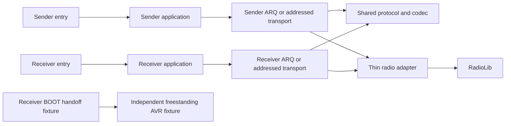

# Final LoRa firmware architecture

## Status

Sender, Receiver, shared protocol, radio access, and the Receiver handoff
fixture have explicit source owners. The 19 role-bearing images build and the
final link maps select the intended transaction role. Active BOOT/APPCODE
pairing and FOTA installation remain blocked; the offline handoff fixture does
not install firmware.

## Board roles and source ownership

| Component | Owns | Main source locations |
|---|---|---|
| Gateway Sender APPCODE | Gateway lifecycle, outgoing DATA, Sender transaction state, ACK/NACK correlation and retries | `src/sender/appcode/`, `stable_lib/arq/sender.cpp` |
| Tracker Receiver APPCODE | Receive lifecycle, address/session checks, DATA acceptance, duplicate handling and ACK/NACK response | `src/receiver/appcode/`, `stable_lib/arq/receiver.cpp` |
| Shared protocol | SSOT addressed transport, ARQ ingress, frame definitions and wrap-safe deadline arithmetic | `src/shared/protocol/`, `stable_lib/ssot/`, `stable_lib/arq/` |
| Radio boundary | Existing addressed LoRa adapter and ARQ radio ingress to RadioLib | `src/shared/radio/` |
| Receiver BOOT | Standalone handoff fixture only | `src/receiver/bootloader/handoff/` |

The portable ARQ algorithms and the SSOT codec remain in `stable_lib`; they are
not copied into `src/shared`. `arq_deadline.h` contains the one inline
wrap-safe comparison shared by both ARQ roles. Each role app includes its own
ARQ header. The final `sender_arq` map extracts the Sender application and
`libarq.a(sender.cpp.o)`; the `receiver_arq` map extracts the Receiver pair.
Neither ARQ map references the opposite application source. No one application
entry includes the other board's lifecycle.

## Protocol boundaries

- **SSOT addressed transport:** four-byte destination/source/campaign header,
  followed by type, sequence, and DATA bytes. Addresses, campaign, sequence,
  and payload acceptance remain validated before delivery. ACK and NACK use
  the existing types and byte encoding.
- **ARQ bench protocol:** independent versioned 12-byte header with 32-bit
  session, 16-bit sequence, and reason field. Its state machines, tests, and
  reverse diagnostic direction remain separate from SSOT.
- **MVP and raw diagnostics:** existing test formats remain distinct; no
  protocol merge or duplicate runtime codec was introduced.

## Build and safety boundary

PlatformIO source filters choose one physical Sender or Receiver entry per
target. All 19 supported role-bearing environments pass. Link-map inspection
found no `src/receiver/bootloader` source in the APPCODE maps; `avr-objdump`
found zero SPM instructions across the 19 APPCODE ELFs. Radio settings, pin
assignments, linker origins, fuses, and wire formats are unchanged.

The handoff fixture is 48 bytes and validates the historical reset vector
before transferring to `0x5800`; blank and altered vectors park. The active
Receiver configuration still reports `BOOTSIZE=0` and application start
`0x0000`, so it does not provide the distinct approved BOOT/APPCODE split needed
for installation. The fixture is not an installer. See the
[BOOT boundary guide](../../src/receiver/bootloader/README.md),
[ACK/NACK guide](../testing/LORA_ACK_NACK.md),
[regression matrix](../testing/REGRESSION_MATRIX.md), and
[hardware pin audit](../../PIN_MAPPING_AUDIT.md).
