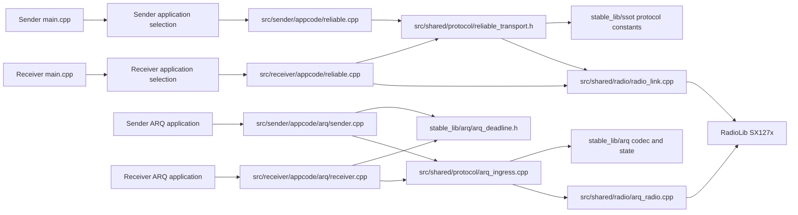
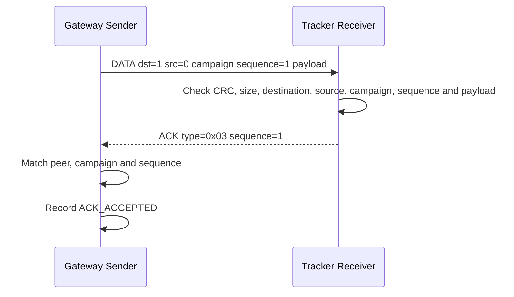
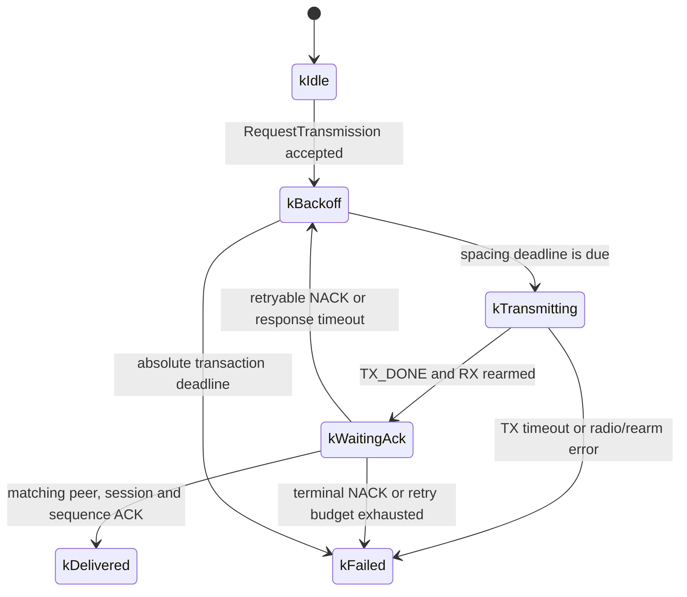
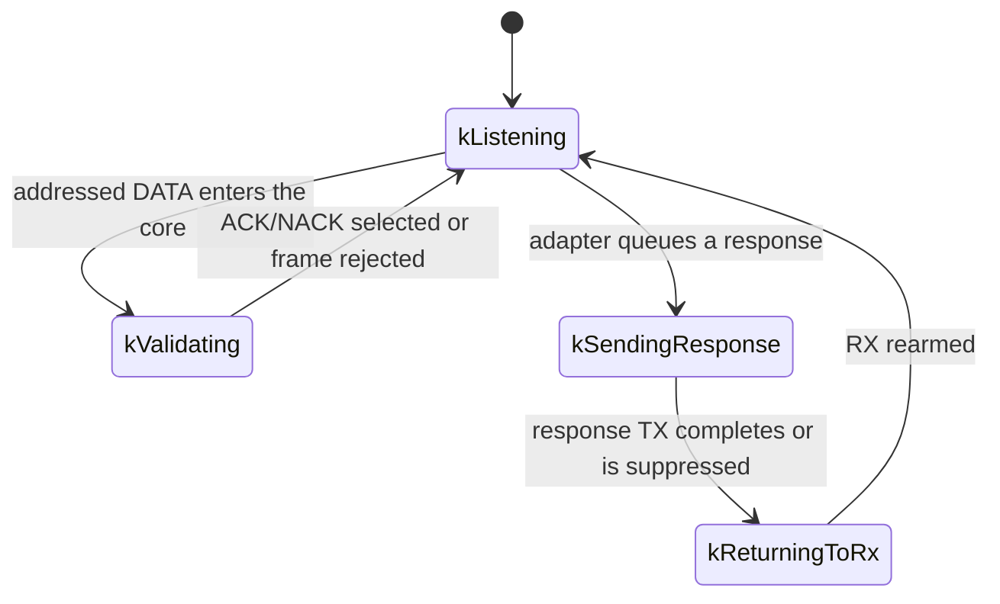

# LoRa ACK/NACK analysis and verification

## Production bench repair report

**Situation.** The debugger's first checkpoint required an upload receipt
before reading either target and expected the separate `sender_hello` console.
The production pair also had two session failures. A rejected first DATA
could bind the Tracker and a recoverable Gateway error could change campaigns
while the Tracker was still bound to the previous one.

**Task.** Verify and exercise the production `sender` and `receiver` images
using the existing addresses, 11-byte `hello world` payload, and DATA,
ACK, and NACK framing. Restrict programming to live APPCODE pages.

**Action.** The Gateway UPDI console and ESP32 I²C path schedule the same
production radio task. The Tracker commits a campaign on application
acceptance and replies to exact duplicates without delivering twice. The
Gateway retains its campaign and outstanding bytes across a recoverable error,
starts a new bounded budget on an explicit retry, and advances sequence only
after a matching ACK. The debugger checks generated inputs, ELF/HEX geometry,
enrolled target identity, and fresh full-page Flash before opening monitors.
An eligible and explicitly authorized write uses the existing AVRDUDE page
programmer, verifies the serial and fuses in the programming session before
erasing, and compares protected memories afterward.

**Result.** Live UPDI identified both enrolled AVR128DA28s with signature
`1e970a`. Both returned `BOOTSIZE=0x00`, `CODESIZE=0x00`, and
`BODCFG=0x00`. Both full-page readbacks differed from their production
images. The live fuse setting classifies all Flash as BOOT on these targets, so
preparation stopped at checkpoint 1. No firmware was written. Running build
IDs, SPI and radio register measurements, DATA/ACK, NACK, retry counts, reset
recovery, and live standby are **NOT RUN** for the production images. The
debugger saves the exact results, readback hashes, and serial captures beneath
`artifacts/rf-debug/<UTC run>/`. [Microchip AVR DA Flash section table](https://onlinedocs.microchip.com/oxy/GUID-CBA6F7C8-69DB-44BF-ACE3-6949CC30E98A-en-US-5/GUID-1FBA83BB-35A7-4B9D-A92E-8A9C7CB8DED6.html)

PlatformIO built all 19 production and diagnostic environments with zero
compiler warnings. The production Gateway uses 41,486 bytes of Flash and
8,759 bytes of static SRAM. The Tracker uses 37,484 bytes of Flash and
4,183 bytes of static SRAM. These SRAM totals exclude runtime stack usage.
The host suite ran 442 tests with 441 passing and one skipped. Ruff, Ruff
format checking, and MyPy passed through `mise run lint:python`. The dry
run exited 0. The interactive readback exited 2 and released both ports.
Standalone `q` and Ctrl-C cancellation checks exited 130. Bench standby
after an active RF exchange still requires the matching installed images.

### Runbook

Run these commands from the repository root:

```sh
mise install
uv sync --locked
uv run --locked python --version
uv run --locked python -m tools.debug_protocol_ack_nack --help
uv run --locked python -m unittest discover -s tests -p 'test_*.py'
mise run lint:python
mise run debug_protocol_ACK_NACK --dry-run
mise run debug_protocol_ACK_NACK --interactive --no-flash
```

The dry run validates the generated headers and INI, refreshes the ignored
manifests, and inspects the linked production images without opening live
ports. In interactive mode, Enter runs the selected checkpoint, `r` retries,
`b` moves back, and `l` shows capture lines. `q` and Ctrl-C request standby
and release any acquired monitors. Stable port aliases are optional via
`--gateway-port` and `--tracker-port`. Both aliases must resolve to the
enrolled adapters in [the hardware inventory](../../config/current_hardware.json).

For an established 915 MHz RF test arrangement, run the full set without
interactive prompts:

```sh
mise run debug_protocol_ACK_NACK --no-flash --authorize-rf-test
```

1. Build `sender` and `receiver`, verify both target serials and fuse geometry,
   and compare installed Flash to the expected rounded image pages.
2. Confirm both running build IDs, independent SPI version reads, the live
   PHY registers, Tracker radio enable and SD chip select, and fresh RX
   readiness. The bench holds Tracker replies disabled during this checkpoint.
3. Capture one controlled Gateway DATA TX completion and Tracker reception.
4. Verify DATA from Gateway address 0 to Tracker address 1, campaign, sequence
   1, radio CRC, and all 11 bytes of `hello world`.
5. Verify on-air ACK type `0x03`, sequence 1, TX completion on the Tracker
   and acceptance on the Gateway. Complete ten DATA/ACK trials.
6. Run ten one-shot payload rejections. Require a NACK on air, matching
   Gateway NACK handling, a retry, and final ACK acceptance for each.
7. Run ten wrong-destination and ten duplicate-DATA trials, fixed malformed
   DATA and invalid ACK cases, four-attempt exhaustion, explicit retry, and
   coordinated UPDI reset recovery.
8. Verify both radios returned to standby, release the serial handles, and
   inspect `summary.json`, `gateway.log`, `receiver.log`, and `events.jsonl`.

Exit status is 0 for success, 1 for a test or build failure, 2 for a blocked
prerequisite, and 130 for cancellation. `--verbose` mirrors raw diagnostics.
When a different enrolled target layout has eligible APPCODE pages and the
exact write is approved, pass `--write-approval /path/to/approval.json` in
place of `--no-flash`. The approval contains one entry per mismatched role,
keyed by `GATEWAY` or `RECEIVER`, with `serial_number`,
`firmware_sha256`, `start`, and `end` as printed by preparation. `end` is
exclusive. Preparation publishes `physical-upload.json` only after both
images verify and always rechecks live Flash on a new run.

### Installed SRAM-only pair

Use the installed runner when fresh readback matches the reviewed
`sender_hello` and `receiver` pair. It checks both enrolled MCU identities,
the full saved Flash dumps and both running build IDs before sending DATA.
The readback directory must come from a read-only capture of both currently
connected targets.

```sh
uv run --locked python -m tools.installed_rf \
  --readback <fresh-readback-directory> \
  --historical-receipt artifacts/rf-proof/20261118T095311Z/physical-upload.json \
  --authorize-rf-test
```

The Tracker's installed `N` command rejects the next DATA in SRAM. The Gateway
must receive the matching NACK over RF, retry, and accept the ACK for the same
campaign and sequence. The runner disconnects the Tracker UPDI monitor
during RF and reopens it after the Gateway terminal event. Tracker evidence
collected after reopening has `delivery=after_rf_reopen` in `events.jsonl`.
Embedded `T=` values are per-device uptime. Host timestamps record receipt
and cannot establish radio timing across the two devices.

Raw per-connection logs and the correlated trial results are in
`artifacts/rf-debug/sram-rf-*/`. A dropped capture does not issue another DATA
command. Failed evidence stops the batch and both installed radios are parked
using their existing sleep command.

## Historical baseline evidence

| Area | Result | Evidence |
|---|---|---|
| Source ownership and build selection | PASS | 19 role-bearing PlatformIO environments, with separate Sender and Receiver entry points |
| ARQ role isolation | PASS | Final link maps extract only the matching role app and transaction objects; APPCODE maps contain no BOOT source |
| Firmware build matrix | PASS: 19/19, 0 warnings | PlatformIO Core 6.2.0; Sender 38,794 B Flash / 7,079 B static RAM; largest Flash image 38,794 B |
| Host tests | PASS: 434 run, 433 passed, 1 skipped | `reports/static_analysis/host_tests.txt`; skip is the historical BOOTSIZE=44 repair case, inapplicable to the current Receiver geometry |
| C++ quality gate | PASS, exit 0 | `bash scripts/quality/check_cpp.sh`; Clang-Tidy, Analyzer, IWYU, clang-doc, Lizard, jscpd, Doxygen and selected AVR builds passed |
| Python lint, format, and types | PASS | `mise run lint:python`; Ruff, Ruff format, and MyPy (72 files) |
| Offline BOOT handoff fixture | PASS | 48-byte image at `[0x0000, 0x0030)`; valid reset vector jumps to `0x5800`, blank/altered vectors park with interrupts disabled |
| Physical DATA/ACK trials | BLOCKED | Passive scan found no devices and /dev/serial/by-path is absent |
| Wrong-destination physical trials | BLOCKED | No identified Sender or Receiver hardware |
| RF timing, fuse readback, power-failure recovery | NOT TESTED | No hardware sessions were run |
| Active BOOT/APPCODE pairing and FOTA installer | BLOCKED | No approved active memory pairing or installer implementation |

The checkout initially failed every PlatformIO build before compilation because
the canonical generator reported stale generated artifacts. The source configs
were unchanged. Regeneration through tools/config/generate_lora_config.py
restored the checked-in outputs from their owners. The stale artifacts were
format differences in generated headers and stale provenance fingerprints.

Graphify was queried before source inspection at 3,505 nodes, then refreshed
after the edits to 3,612 nodes and 7,011 edges. CodeGraph MCP reported that the
repository had no usable index. Important callers and wire behavior were
verified against source and linked builds. The passive device scan returned
MISSING for both roles and reported no /dev/serial/by-path directory. No upload
or RF transmission was attempted.

## Source ownership and dependency map

| Responsibility | Owner | Selected environments |
|---|---|---|
| Normal Gateway application and host interface | src/sender/appcode/gateway | sender |
| Addressed SSOT sender transaction | src/sender/appcode/reliable.cpp and src/shared/protocol/reliable_transport.h | sender_hello |
| Tracker application and addressed SSOT receiver | src/receiver/appcode/reliable.cpp and src/shared/protocol/reliable_transport.h | receiver |
| Sender ARQ application adapter | src/sender/appcode/arq/sender.cpp | sender_arq, sender_arq_test, sender_arq_radio_only |
| Receiver ARQ application adapter | src/receiver/appcode/arq/receiver.cpp | receiver_arq, receiver_arq_test, receiver_arq_radio_only |
| Shared addressed radio wrapper | src/shared/radio/radio_link.cpp and stable_lib/ssot/ssot_radio_header.h | sender_hello, receiver |
| Shared ARQ radio ingress | src/shared/protocol/arq_ingress.cpp and src/shared/radio/arq_radio.cpp | ARQ variants |
| Portable ARQ codec and algorithms | stable_lib/arq | ARQ variants and host tests |
| Wrap-safe shared deadline comparison | stable_lib/arq/arq_deadline.h | Sender and Receiver ARQ adapters |
| Receiver handoff fixture | src/receiver/bootloader/handoff | Offline fixture only |

The two wire protocols are separate by design. The SSOT addressed transport
uses a four-byte radio header and a two-byte type/sequence control payload. The
bench ARQ transport uses its own versioned 12-byte header, 32-bit session ID,
16-bit sequence, and reason byte. MVP and reverse-raw targets retain their own
legacy test formats.



The production Gateway target selects gateway_app. The sender_hello test target
selects the addressed Sender application. Reverse ARQ diagnostics intentionally
swap transaction direction while retaining the selected physical board entry,
pins, and power sequencing.

The addressed runtime transport constructs its type, sequence, and payload
fields directly and uses the shared SSOT constants. The standalone
`stable_lib/ssot/ssot_codec.cpp` codec is exercised by codec tests and legacy
consumers; it is not a second runtime encoder used by this transport.

Both ARQ apps include their own role header. `IsDeadlineDue` is an inline
wrap-safe millisecond comparison in `stable_lib/arq/arq_deadline.h`; moving it
there removed the Receiver image's dependency on `sender.cpp` for one shared
helper. Final link maps show only the matching role's transaction object and
library member in each ARQ ELF.

## SSOT addressed DATA, ACK, and NACK

The normal reliable test uses sender address 0, receiver address 1, a 16-bit
campaign ID, and sequence 1. The radio header stores destination, source, then
the campaign ID little-endian. The application payload stores type, sequence,
then DATA bytes. ACK and NACK contain only type and sequence after the radio
header.

| Frame | Bytes for campaign 0x1234 |
|---|---|
| DATA | 01 00 34 12 08 01 68 65 6C 6C 6F 20 77 6F 72 6C 64 |
| ACK | 00 01 34 12 03 01 |
| NACK | 00 01 34 12 09 01 |

DATA type is 0x08, ACK is 0x03, and NACK is 0x09. The accepted payload is the
11 ASCII bytes hello world, without a NUL terminator. The radio CRC is enabled
by the RadioLib adapter and is not part of these application bytes.

The current SSOT PHY profile is 915.000 MHz, 125 kHz bandwidth, SF7, coding
rate 4/5, sync word `0x12`, 2 dBm configured TX power, eight preamble symbols,
CRC enabled, explicit header, normal IQ, and a 200 mA configured current
limit. The pinned RadioLib 7.1.2 SX127x implementation maps coding-rate value
5 to 4/5; `automatic_gain = 0` enables its AGC path. These are configuration
values, not physical register readback. The ARQ test config records a 1 MHz SPI
rate, but the addressed `LoRa` adapter does not set an explicit SPI clock, so
the effective addressed-path SPI rate has not been measured. [RadioLib 7.1.2
SX1278 implementation](https://raw.githubusercontent.com/jgromes/RadioLib/7.1.2/src/modules/SX127x/SX1278.cpp),
[RadioLib 7.1.2 SX1278 header](https://raw.githubusercontent.com/jgromes/RadioLib/7.1.2/src/modules/SX127x/SX1278.h).

The production sender path is

1. The `sender` Gateway scheduler receives a request from UPDI or ESP32 I²C.
2. Initialize arms the shared Transport with the Sender address, expected peer,
   payload validator, and a generated nonzero campaign ID.
3. A request copies the application bytes into fixed storage and starts DATA TX.
4. Poll waits for radio TX completion, then waits for the configured ACK timeout.
5. RX must match destination, source, campaign, packet type, size, and sequence.
6. A matching ACK enters kComplete and records ACK_ACCEPTED. A matching NACK
   or timeout schedules a bounded retry while attempts remain.

The receiver checks CRC and frame size in the adapter path, then checks
destination, expected source, nonzero campaign, and control-frame shape in
software. LoRa mode does not provide the FSK node-address hardware filter.
Malformed, truncated, CRC-failed, wrong-destination, wrong-source, and
unrelated-campaign frames are discarded before application acceptance and
produce no ACK or NACK.

An addressed DATA frame reaches the payload callback only after those checks.
The callback accepts only the configured payload. The transport records a
successful sequence before sending ACK. If the same campaign, sequence, length,
and bytes arrive again after a lost ACK, it sends the ACK again without
reapplying the payload. A new addressed DATA with invalid content or sequence
receives a correlated NACK. Short packets and unknown control types are ignored.



| Case | Receiver behavior | Sender behavior |
|---|---|---|
| Valid first DATA | Accept once and send ACK | Accept only a matching ACK |
| Duplicate DATA after lost ACK | Do not repeat application delivery; resend ACK | Retry within the bounded attempt budget |
| Invalid payload or unexpected sequence | Send a correlated NACK for addressed valid DATA | Accept only a matching NACK, then retry or fail |
| Wrong destination, source, or campaign | Discard before application callback; no response | Do not accept unrelated control traffic |
| CRC, truncated header, malformed control | Discard | Wait for timeout, then bounded retry |
| Lost DATA or ACK | No fake receive event; receiver may remain silent | Timeout and bounded retry |
| Retry exhaustion | No further response needed | Enter a terminal failure state |

## Bench ARQ protocol

The ARQ codec explicitly serializes fields and never sends the native C struct.
Its 12-byte header is

| Offset | Field | Encoding |
|---:|---|---|
| 0 | Wire version | 1 |
| 1 | Type | DATA 1, ACK 2, NACK 3 |
| 2 | Source | 8-bit node ID |
| 3 | Destination | 8-bit node ID |
| 4-7 | Session | 32-bit little-endian |
| 8-9 | Sequence | 16-bit little-endian |
| 10 | Payload length | 8-bit byte count |
| 11 | Reason | 0 for DATA/ACK; 1 unexpected sequence, 2 application reject, 3 busy |

The ARQ test config sets sender ID 1, receiver ID 2, a 32-byte payload limit,
and the separate payload Hello World. This uppercase payload belongs to the ARQ
test and is not the lowercase SSOT acceptance payload.



The Receiver algorithm uses kListening, kValidating, kSendingResponse, and
kReturningToRx. It discards unrelated frames without changing acceptance
counters. It ACKs an already accepted duplicate without delivering it again.

The ARQ request chooses an ACK window between 2000 and 3000 ms. max_retries=4
means four retransmissions after the first send, for at most five attempts.
The TX timeout is 3000 ms, response guard is 75 ms, and the minimum spacing
between TX starts is 10000 ms. Retry spacing is bounded and the transaction has
an absolute deadline.



## Test coverage

The host tests exercise both implementations with deterministic radios and
clocks. The SSOT transport test checks addressed delivery, wrong destination,
wrong source, stale campaigns, wrong sequence, duplicate ACK replay, NACK
retry/exhaustion, TX/RX failures, timeout wraparound, and payload bounds. Its
loss simulation uses fixed seeds across 0, 1, 5, 10, 20, 30, 50, and 100 percent
packet loss. The ARQ core test checks every 16-bit sequence value, mismatched
session/sequence controls, duplicate delivery, retry exhaustion, and rollover.
The bounded parser fuzz test uses seed 0x4c4f5241 and 50000 inputs.

The final host run executed 434 tests: 433 passed, zero failed, and the one
historical BOOTSIZE=44 package case was skipped because its geometry does not
match the current Receiver target. Fixed-seed loss simulation and codec golden
bytes passed as host evidence only; they are not RF measurements. The C++ gate
also built `sender_hello`, `receiver`, `sender`, `sender_arq_test`, and
`receiver_arq_test` with zero compiler warnings.

The full 19-target Flash and static-SRAM table, exact build command, host
results, and supported/unsupported quality checks are in the
[regression matrix](REGRESSION_MATRIX.md).

The approved-plan historical baseline for the default Sender/Receiver images was
38,820/7,079 B and 35,908/3,842 B. The current images are 38,794/7,079 B and
35,788/3,849 B. They match the first clean 19-target build before this loop's
ARQ-only boundary change; the historical-baseline size differences predate that
change.

Relevant tests include

| Test | Coverage |
|---|---|
| tests/reliable_transport_test.cpp | SSOT ACK/NACK state, bounded retries, duplicates, wrong destination, and loss simulation |
| tests/arq/core_test.cpp | ARQ frame codec, sequence matrix, session matching, receiver delivery, and retry limits |
| tests/arq/directional_test.cpp | Direction-specific adapter behavior and reverse transaction selection |
| tests/test_mvp_roundtrip.py | Legacy MVP DATA/ACK/NACK behavior, kept separate from SSOT |
| tests/test_rf_stable_transport.py | Hardware evidence requirements for DATA/ACK, NACK, duplicate, lost ACK, and wrong destination |
| tests/test_rf_proof.py | Hardware identity, authorization, preflight, and evidence validation |
| tests/test_receiver_boot.py | Offline handoff vector and range checks; physical install remains blocked |

Run the complete host suite with

    uv run --no-sync python -m unittest discover -s tests -v

Run the C++ quality gate and Python lint/type tasks with

    bash scripts/quality/check_cpp.sh
    mise run lint:python

Build all 19 role-bearing targets with the resolved environment names from
platformio.ini. The default pio run builds sender and receiver only.

## Historical hardware trial requirements and result

A physical PASS requires independent paired logs for every trial. Each valid
trial must show DATA TX, all 11 payload bytes accepted by the Tracker, ACK type
0x03 and sequence 1 transmitted, and a matching ACK accepted by the Gateway.
Each wrong-destination trial must show zero application acceptance and zero
ACK/NACK transmissions. Host tests and parser simulations do not count as RF
trials.

This session found no serial adapters under /dev/serial/by-path and the passive
inventory reported both roles missing. Therefore the requested 10 valid
DATA/ACK and 10 wrong-destination hardware trials are BLOCKED and NOT RUN.
Physical NACK retransmission, latency, fuse readback, RF timing, and power-loss
recovery are also NOT TESTED. No firmware was uploaded and no RF was transmitted.

The current target configuration reports receiver BOOTSIZE=0 and application
start 0. The active BOOT/APPCODE pairing remains BLOCKED until an approved
memory layout exists. The handoff fixture is offline evidence only and does not
implement image staging or Flash installation. See
[Receiver BOOT boundary](../../src/receiver/bootloader/README.md),
[Microchip AN3341](https://onlinedocs.microchip.com/oxy/GUID-CBA6F7C8-69DB-44BF-ACE3-6949CC30E98A-en-US-5/GUID-1FBA83BB-35A7-4B9D-A92E-8A9C7CB8DED6.html),
and the [AVR128DA silicon errata DS80000882F](https://ww1.microchip.com/downloads/aemDocuments/documents/MCU08/ProductDocuments/Errata/AVR128DA-28-32-48-64-SilConErrataClarif-DS80000882.pdf).
The current physical trial record is in the
[real-radio evidence ledger](REAL_RADIO_EVIDENCE.md).

## Documentation audit

The active documentation set contains 28 Markdown files; all 91 relative links
resolve. The tracked Markdown count remained 19; ten requested guides were
added and are visible as untracked files. The full scan found 66 Markdown files
on disk, including 37 ignored or archived files. No document was deleted or
consolidated because the historical refactoring reports and radio captures
retain unique evidence.
The ignored archival snapshot `artifacts/rf-proof/20261116T043313Z/report.md`
contained 18 stale absolute source links. Their labels and captured paths are
now literal text, with the original copied to
`/tmp/lora-v4-evidence/report.md.before-link-cleanup`; the full 66-file scan now
has no broken relative links.
